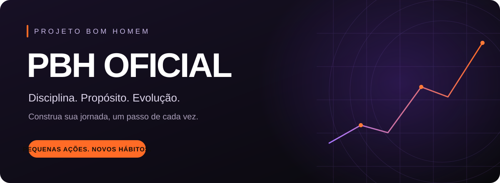
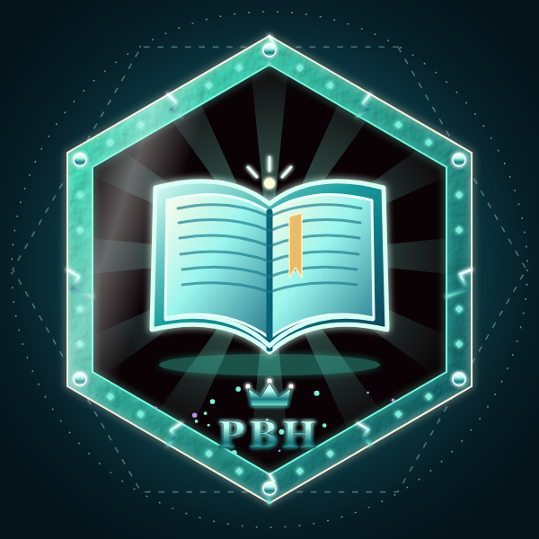
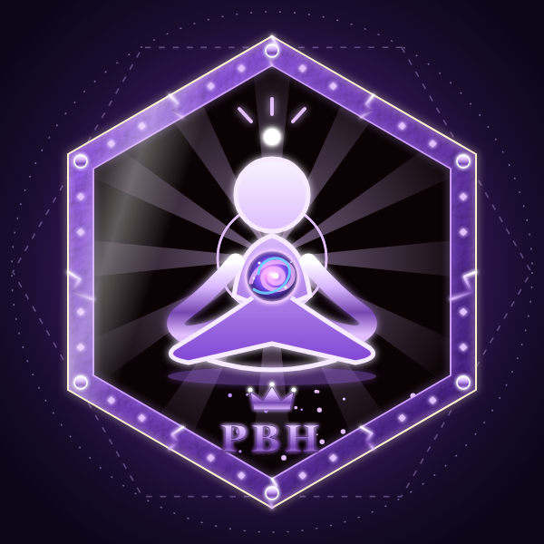
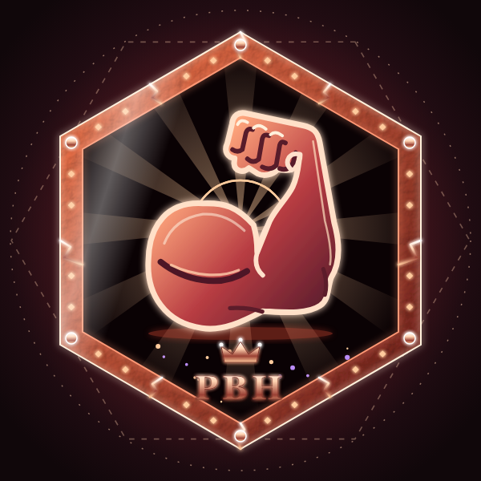
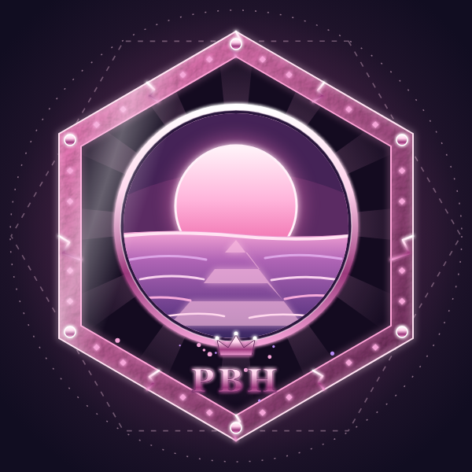

  

  <strong>Seu próximo passo começa hoje.</strong>

  <a href="#uma-jornada-com-propósito">Conheça o PBH</a> ·
  <a href="#o-que-você-encontra-no-app">Explore o app</a> ·
  <a href="#um-perfil-com-a-sua-identidade">Sua identidade</a>

## Uma jornada com propósito

O **PBH Oficial — Projeto Bom Homem** reúne hábitos, desafios, aprendizado e comunidade em um só lugar. Um espaço para transformar intenção em ação, acompanhar suas conquistas e construir uma rotina com mais foco e propósito.

**Não precisa fazer tudo hoje. Escolha um passo e comece por ele.**

## O que você encontra no app

| | Explore sua jornada |
| :--- | :--- |
| 🔥 **Hábitos e constância** | Registre sua rotina, acompanhe sequências e dê atenção ao que quer manter no dia a dia. |
| 🎯 **Desafios e conquistas** | Encare objetivos, registre seu avanço e conquiste selos ao longo do caminho. |
| 📚 **Conteúdos para refletir** | Explore programas com módulos, aulas, práticas e recomendações de vídeos sobre os temas estudados. |
| 🤝 **Comunidade** | Compartilhe experiências, tire dúvidas, celebre conquistas e converse com outros membros. |
| 🎵 **Música** | Encontre no app um espaço para acompanhar sua rotina com música. |
| 🧭 **Objetivos pessoais** | Defina o que deseja alcançar, escolha seu próximo passo e registre os avanços da jornada. |

## Aprender. Praticar. Evoluir.

Conhecimento ganha força quando encontra espaço na rotina. Os programas conectam reflexão e prática em temas como **hábitos, disciplina, liderança, estoicismo, corpo e sentido da vida**.

Escolha um assunto, avance pelas aulas e retome de onde parou. Suas anotações e o registro das conclusões ajudam a acompanhar o caminho percorrido.

## Cada conquista conta

Mais do que números, os selos representam marcos da sua história: leitura, foco, treino, descanso e dedicação ao projeto.

  
  &nbsp;
  
  &nbsp;
  
  &nbsp;
  

Marcos diferentes. Uma jornada que é sua.

## Um perfil com a sua identidade

Sua história também aparece nos detalhes. Personalize a foto, a capa, a moldura e o tema; escolha os selos que quer destacar e as animações que combinam com você.

| Atmosfera | Efeitos para experimentar |
| :--- | :--- |
| 🌧️ **Natureza** | Chuva, neve e vaga-lumes. |
| ✨ **Luz e movimento** | Órbita de luz, pulso suave, anéis, estrelas, aurora e brasas. |
| 🎃 **Celebrações** | Halloween, Natal e Ano Novo. |

Os efeitos animados têm **intensidade ajustável**, com prévia durante a personalização. Algumas opções são desbloqueadas pelas conquistas; outras são exclusivas do fundador.

## Sua rotina, no seu ritmo

- **Retome seu próximo passo:** acompanhe o progresso e os resumos da sua jornada.
- **Escolha o que compartilhar:** mantenha objetivos e registros pessoais privados ou compartilhe as informações permitidas pelo app.
- **Controle os avisos:** gerencie notificações e sons nas configurações.
- **Leve sua identidade com você:** use temas e personalizações para deixar o espaço com a sua cara.

---

  <strong>PBH Oficial · Projeto Bom Homem</strong> 
  Uma rotina com propósito se constrói todos os dias.

Documentação de desenvolvimento

As instruções de execução, configuração e manutenção estão no [guia técnico](docs/technical-guide.md).

